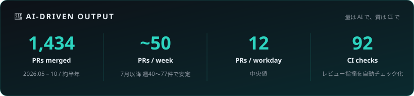
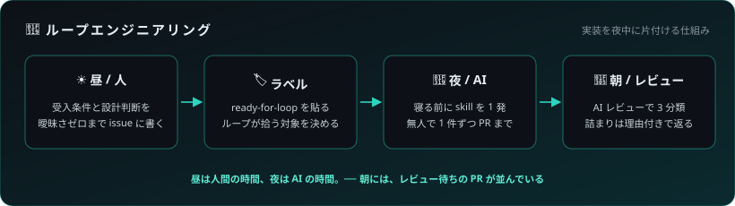

  
  
  
  

### 👋 自己紹介

AI に「作業」ではなく **「ループそのもの」** を回させるエンジニアです。
設計は人が練り、実装は AI が回し、品質は CI が守る。人は **入口（設計判断）** と **出口（マージ判断）** に集中します。

### 🤖 AI との働き方

### 💡 大事にしていること

| | |
|---|---|
| ⚙️ **AI を止めない** | とにかく AI を動かし続ける。自動で動ける環境を整える |
| ✅ **信じる根拠をつくる** | 一度した指摘は CI チェックにする。機械が担保できる部分は人が見ない |
| 📝 **ドキュメントを残す** | 意思決定を issue に残し、属人化をなくす。人が根拠を忘れても拾えるように |

### 🎤 登壇

- **2026.10** — AI で PR を出し続けた半年と、質を守るための CI ── *量は AI で、質は CI で*
- **2026.07** — 実装を夜中に片付ける仕組み作り ── *AI にループを回させて、寝ている間に PR を積む*

### 📊 アクティビティ

数値は件数の集計のみ。GitHub Actions で毎日自動更新しています。

